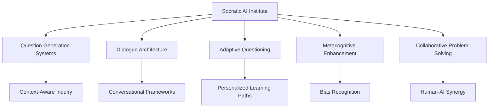

# 🤔 The Socratic AI Institute

> *"The only true wisdom is in knowing you know nothing."* — Socrates

**Pioneering AI that asks better questions than any answer it could provide**

---

## 🌟 What if AI helped us think better instead of thinking for us?

The Socratic AI Institute is reimagining the future of human-AI collaboration. Instead of building systems that simply provide answers, we're developing AI that serves as an intelligent questioning partner—one that enhances human reasoning, creativity, and understanding through the power of inquiry.

### 🎯 Our Mission

To create AI systems that work **with** humans rather than **for** them, preserving and amplifying human intellectual agency in an increasingly automated world.

---

## 🧭 Navigation

### 📖 Core Documentation

| Document | Description | Status |
|----------|-------------|---------|
| **[The Vision](./socratic-ai-intro.md)** | Core philosophy and approach to human-AI collaboration | ✅ Complete |
| **[Stakeholder Ecosystem](./stakeholder-overview.md)** | Our founding partners and their unique contributions | ✅ Complete |
| **[Launch Roadmap](./short-term-goals.md)** | Initial goals: team formation, research study, and hackathon | ✅ Complete |

---

## 🚀 The Paradigm Shift

### Traditional AI: *Working FOR Humans*
```
Human asks question → AI provides answer → Human accepts result
```
**Result**: Passive consumption, reduced critical thinking

### Socratic AI: *Working WITH Humans*
```
Human presents challenge → AI asks probing questions → Human discovers insights → Collaborative understanding
```
**Result**: Enhanced reasoning, preserved agency, deeper understanding

---

## 🏛️ Our Foundation

### 🔬 **Flying Pig Labs**
*Technical Innovation & Research*
- Core algorithm development
- Experimental AI frameworks
- Rapid prototyping

### 🎓 **UR Innovation Studio** 
*Academic Excellence & Research Infrastructure*
- Theoretical foundations
- Educational integration
- Peer-reviewed research

### 🌍 **AI Ready RVA**
*Community Engagement & Workforce Development*
- Local business integration
- Professional training
- Public education

### 🎨 **Lost Office Collaborative**
*Creative Innovation & Interdisciplinary Thinking*
- Artistic exploration
- Cultural innovation
- Alternative perspectives

---

## 🎯 Immediate Objectives

### **Phase 1: Foundation** *Months 1-6*
- 👥 **Team Assembly**: Build core interdisciplinary research team
- 💰 **Funding**: Secure $150K-$300K seed funding
- 📋 **Research Design**: Develop comparative study framework

### **Phase 2: Validation** *Months 4-9*
- 🔬 **Academic Study**: 100+ participants across multiple domains
- 📊 **Data Collection**: Measure effectiveness vs. traditional AI
- 📝 **Publication**: Peer-reviewed findings

### **Phase 3: Community** *Months 6-12*
- 🏆 **Hackathon**: 48-hour community event
- 🛠️ **Prototypes**: 15+ working Socratic AI applications
- 🤝 **Partnerships**: Industry collaboration opportunities

---

## 🔮 Research Focus Areas



---

## 🌍 Global Impact Vision

### **Education**
Transforming learning from information consumption to guided discovery

### **Research** 
Enhancing scientific inquiry through intelligent questioning systems

### **Business Strategy**
Improving decision-making through structured dialogue and critical analysis

### **Personal Development**
Fostering metacognitive skills and self-awareness

---

## 📈 Success Metrics

| Milestone | Timeline | Success Indicator |
|-----------|----------|-------------------|
| **Team Formation** | 3 months | Core team of 5+ researchers assembled |
| **Initial Funding** | 6 months | $150K+ secured for year one operations |
| **Research Launch** | 6 months | IRB approval and participant recruitment complete |
| **Proof of Concept** | 9 months | Working Socratic AI prototypes operational |
| **Community Engagement** | 9 months | Successful hackathon with 100+ participants |
| **Academic Publication** | 12 months | Peer-reviewed research published |

---

## 🤝 Get Involved

### **For Researchers**
Interested in human-AI collaboration? Join our interdisciplinary team.

### **For Educators** 
Want to transform learning through intelligent questioning? Partner with us.

### **For Developers**
Ready to build AI that enhances rather than replaces human thinking? Contribute to our open-source frameworks.

### **For Organizations**
Looking to implement human-centered AI solutions? Explore partnership opportunities.

---

## 📬 Connect With Us

- **Website**: *Coming Soon*
- **Email**: contact@socratic-ai-institute.org *(Placeholder)*
- **GitHub**: *Repository Under Development*
- **Location**: Richmond, Virginia

---

## 🔥 Why This Matters Now

As AI capabilities rapidly expand, we face a critical choice: 

**Will we build AI that thinks for us, or AI that helps us think better?**

The Socratic AI Institute is pioneering the latter path—ensuring that as artificial intelligence grows more powerful, human intelligence grows alongside it.

---

*"The unexamined life is not worth living."* — Socrates

**Join us in examining how AI and humanity can grow together.**

---

<div align="center">

### 🧠 + 🤖 = 🚀

**Human Intelligence × Artificial Intelligence = Amplified Understanding**

*Built with ❤️ in Richmond, Virginia*

</div>
